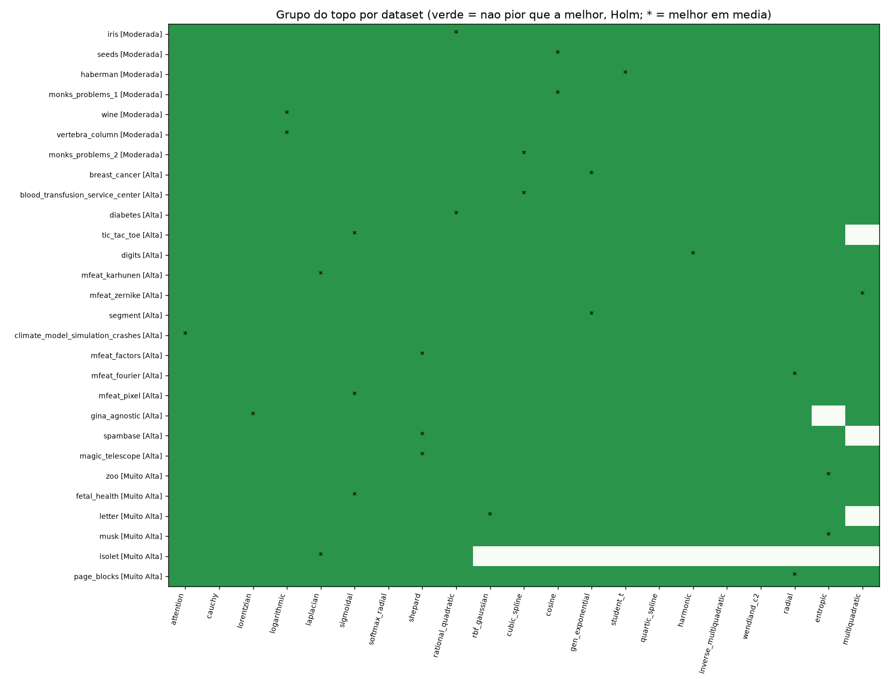
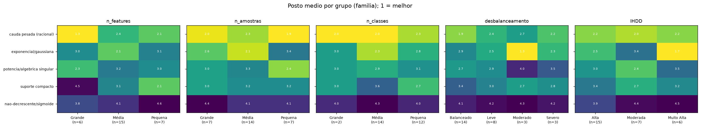
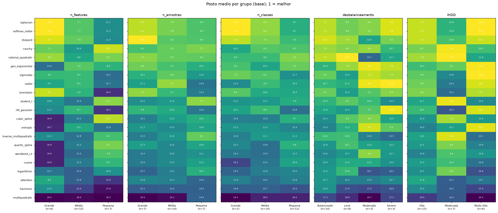

# Bateria estatistica (metrica: balanced_accuracy; alpha = 0.05; margem de equivalencia delta = 0.01)

- Datasets: **28**; bases: **21**; blocos pareados (seed x repeat x fold) por dataset: 30-90.

Metodologia e justificativas: ver `METODOLOGIA.md`.

## A. Por dataset

### A.1 Omnibus (Friedman + Iman-Davenport, ingenuo vs. com tamanho efetivo de amostra)

| dataset                          |   n_blocos |   deff |   n_eff |   p_friedman_naive |   p_friedman_deff |   p_friedman_deff_bh |
|:---------------------------------|-----------:|-------:|--------:|-------------------:|------------------:|---------------------:|
| blood_transfusion_service_center |         90 | 11     |   8.182 |         5.068e-07  |         0.9992    |            1         |
| breast_cancer                    |         90 | 11     |   8.182 |         0.07621    |         1         |            1         |
| climate_model_simulation_crashes |         90 | 11     |   8.182 |         0.4586     |         1         |            1         |
| diabetes                         |         90 | 11     |   8.182 |         0.0004274  |         0.9999    |            1         |
| digits                           |         90 | 11     |   8.182 |         8.103e-13  |         0.987     |            1         |
| fetal_health                     |         90 | 11     |   8.182 |         1.268e-34  |         0.5671    |            1         |
| gina_agnostic                    |         30 |  4.333 |   6.923 |         3.93e-36   |         0.0004252 |            0.001984  |
| haberman                         |         90 | 11     |   8.182 |         0.009639   |         1         |            1         |
| iris                             |         90 | 11     |   8.182 |         0.5142     |         1         |            1         |
| isolet                           |         30 |  4.333 |   6.923 |         4.794e-133 |         1.419e-21 |            2.286e-20 |
| letter                           |         30 |  4.333 |   6.923 |         5.545e-57  |         1.733e-07 |            1.618e-06 |
| magic_telescope                  |         30 |  4.333 |   6.923 |         3.944e-07  |         0.7945    |            1         |
| mfeat_factors                    |         90 | 11     |   8.182 |         2.389e-15  |         0.9716    |            1         |
| mfeat_fourier                    |         90 | 11     |   8.182 |         2.863e-42  |         0.3651    |            0.9294    |
| mfeat_karhunen                   |         90 | 11     |   8.182 |         6.737e-109 |         0.0003166 |            0.001894  |
| mfeat_pixel                      |         90 | 11     |   8.182 |         2.302e-58  |         0.103     |            0.3204    |
| mfeat_zernike                    |         90 | 11     |   8.182 |         1.759e-26  |         0.7882    |            1         |
| monks_problems_1                 |         90 | 11     |   8.182 |         6.654e-25  |         0.8254    |            1         |
| monks_problems_2                 |         90 | 11     |   8.182 |         1.996e-26  |         0.7896    |            1         |
| musk                             |         30 |  4.333 |   6.923 |         9.935e-133 |         1.633e-21 |            2.286e-20 |
| page_blocks                      |         90 | 11     |   8.182 |         7.406e-47  |         0.2656    |            0.7438    |
| seeds                            |         90 | 11     |   8.182 |         0.3898     |         1         |            1         |
| segment                          |         90 | 11     |   8.182 |         2.146e-108 |         0.0003383 |            0.001894  |
| spambase                         |         90 | 11     |   8.182 |         5.768e-92  |         0.002725  |            0.0109    |
| tic_tac_toe                      |         90 | 11     |   8.182 |         1.856e-87  |         0.004691  |            0.01642   |
| vertebra_column                  |         90 | 11     |   8.182 |         0.5751     |         1         |            1         |
| wine                             |         90 | 11     |   8.182 |         0.9937     |         1         |            1         |
| zoo                              |         90 | 11     |   8.182 |         1.049e-31  |         0.6493    |            1         |

Datasets com ao menos uma diferenca detectavel (omnibus corrigido, BH<0.05): **8/28**.

### A.2 Desfecho dos pares (Holm dentro de cada dataset; 3 vias)

| dataset                          |   pares |   diferenca_sig |   so_indicativo |   equivalente |   inconclusivo |   equiv_mas_forma_difere |   wilcoxon_discorda |
|:---------------------------------|--------:|----------------:|----------------:|--------------:|---------------:|-------------------------:|--------------------:|
| blood_transfusion_service_center |     210 |               0 |              15 |             5 |            205 |                        0 |                  13 |
| breast_cancer                    |     210 |               0 |               0 |             5 |            205 |                        0 |                   0 |
| climate_model_simulation_crashes |     210 |               0 |               0 |           210 |              0 |                        0 |                   0 |
| diabetes                         |     210 |               0 |               1 |             1 |            209 |                        0 |                   3 |
| digits                           |     210 |               0 |              11 |           206 |              4 |                        0 |                  14 |
| fetal_health                     |     210 |               0 |              46 |             1 |            209 |                        0 |                  49 |
| gina_agnostic                    |     210 |               4 |              42 |            73 |            133 |                        0 |                  51 |
| haberman                         |     210 |               0 |               8 |             1 |            209 |                        0 |                   4 |
| iris                             |     210 |               0 |               0 |             6 |            204 |                        0 |                   0 |
| isolet                           |     210 |              79 |              68 |            45 |             86 |                        0 |                  65 |
| letter                           |     210 |              20 |              78 |           188 |              2 |                        0 |                  68 |
| magic_telescope                  |     210 |               0 |               9 |           205 |              5 |                        0 |                   3 |
| mfeat_factors                    |     210 |               0 |              37 |           199 |             11 |                        0 |                  30 |
| mfeat_fourier                    |     210 |               0 |              76 |            10 |            200 |                        0 |                  75 |
| mfeat_karhunen                   |     210 |               0 |             100 |           113 |             97 |                        0 |                  99 |
| mfeat_pixel                      |     210 |               0 |              90 |           197 |             13 |                        0 |                  92 |
| mfeat_zernike                    |     210 |               0 |              52 |             5 |            205 |                        0 |                  45 |
| monks_problems_1                 |     210 |               0 |              58 |             2 |            208 |                        0 |                  50 |
| monks_problems_2                 |     210 |               0 |              25 |             2 |            208 |                        0 |                  26 |
| musk                             |     210 |               0 |              84 |           116 |             94 |                        0 |                  99 |
| page_blocks                      |     210 |               0 |              94 |             3 |            207 |                        0 |                  93 |
| seeds                            |     210 |               0 |               0 |             2 |            208 |                        0 |                   0 |
| segment                          |     210 |               4 |             138 |            91 |            115 |                        0 |                 136 |
| spambase                         |     210 |               8 |              92 |            53 |            149 |                        0 |                  94 |
| tic_tac_toe                      |     210 |               3 |             116 |             5 |            202 |                        0 |                 113 |
| vertebra_column                  |     210 |               0 |               0 |             2 |            208 |                        0 |                   0 |
| wine                             |     210 |               0 |               0 |            12 |            198 |                        0 |                   0 |
| zoo                              |     210 |               0 |              20 |            40 |            170 |                        0 |                  20 |

`diferenca_sig` = robusto (sobrevive a correcao N-B + Holm); `so_indicativo` = significativo apenas sem a correcao N-B (Holm). `wilcoxon_discorda` = Wilcoxon ingenuo (Holm) discorda do t corrigido.

### A.3 Grupo do topo por dataset (bases nao significativamente piores que a melhor em media)

| dataset                          | IHDD       | melhor             |   media_melhor |   n_no_topo |   n_no_topo_indicativo | topo                                                                                                                          |
|:---------------------------------|:-----------|:-------------------|---------------:|------------:|-----------------------:|:------------------------------------------------------------------------------------------------------------------------------|
| blood_transfusion_service_center | Alta       | cubic_spline       |         0.6344 |          21 |                     20 | cubic_spline, wendland_c2, quartic_spline, student_t, cauchy, cosine, laplacian, softmax_radial ...                           |
| breast_cancer                    | Alta       | gen_exponential    |         0.959  |          21 |                     21 | gen_exponential, cubic_spline, sigmoidal, entropic, cosine, rbf_gaussian, wendland_c2, radial ...                             |
| climate_model_simulation_crashes | Alta       | attention          |         0.5    |          21 |                     21 | attention, cauchy, cosine, cubic_spline, gen_exponential, radial, harmonic, inverse_multiquadratic ...                        |
| diabetes                         | Alta       | rational_quadratic |         0.6965 |          21 |                     20 | rational_quadratic, cauchy, laplacian, softmax_radial, attention, harmonic, lorentzian, inverse_multiquadratic ...            |
| digits                           | Alta       | harmonic           |         0.978  |          21 |                     20 | harmonic, shepard, logarithmic, inverse_multiquadratic, student_t, rational_quadratic, attention, cauchy ...                  |
| fetal_health                     | Muito Alta | sigmoidal          |         0.8086 |          21 |                     17 | sigmoidal, gen_exponential, radial, wendland_c2, rbf_gaussian, cubic_spline, entropic, lorentzian ...                         |
| gina_agnostic                    | Alta       | lorentzian         |         0.8166 |          20 |                     17 | lorentzian, attention, harmonic, rational_quadratic, shepard, laplacian, softmax_radial, cauchy ...                           |
| haberman                         | Moderada   | student_t          |         0.6062 |          21 |                     18 | student_t, logarithmic, inverse_multiquadratic, rational_quadratic, multiquadratic, radial, cauchy, gen_exponential ...       |
| iris                             | Moderada   | rational_quadratic |         0.9704 |          21 |                     21 | rational_quadratic, shepard, cauchy, sigmoidal, cosine, wendland_c2, quartic_spline, cubic_spline ...                         |
| isolet                           | Muito Alta | laplacian          |         0.9167 |           9 |                      5 | laplacian, softmax_radial, shepard, lorentzian, rational_quadratic, attention, cauchy, logarithmic ...                        |
| letter                           | Muito Alta | rbf_gaussian       |         0.9498 |          20 |                     12 | rbf_gaussian, entropic, sigmoidal, gen_exponential, radial, softmax_radial, laplacian, shepard ...                            |
| magic_telescope                  | Alta       | shepard            |         0.7975 |          21 |                     20 | shepard, cosine, rbf_gaussian, gen_exponential, quartic_spline, rational_quadratic, radial, inverse_multiquadratic ...        |
| mfeat_factors                    | Alta       | shepard            |         0.9687 |          21 |                     14 | shepard, laplacian, softmax_radial, rational_quadratic, cauchy, lorentzian, radial, student_t ...                             |
| mfeat_fourier                    | Alta       | radial             |         0.804  |          21 |                     14 | radial, laplacian, softmax_radial, sigmoidal, rational_quadratic, shepard, cauchy, lorentzian ...                             |
| mfeat_karhunen                   | Alta       | laplacian          |         0.9621 |          21 |                      7 | laplacian, softmax_radial, sigmoidal, radial, rbf_gaussian, entropic, gen_exponential, lorentzian ...                         |
| mfeat_pixel                      | Alta       | sigmoidal          |         0.9796 |          21 |                     14 | sigmoidal, rbf_gaussian, laplacian, softmax_radial, radial, lorentzian, shepard, rational_quadratic ...                       |
| mfeat_zernike                    | Alta       | multiquadratic     |         0.8183 |          21 |                      2 | multiquadratic, radial, rbf_gaussian, cauchy, laplacian, softmax_radial, rational_quadratic, sigmoidal ...                    |
| monks_problems_1                 | Moderada   | cosine             |         0.8838 |          21 |                     12 | cosine, quartic_spline, rational_quadratic, cubic_spline, wendland_c2, gen_exponential, cauchy, inverse_multiquadratic ...    |
| monks_problems_2                 | Moderada   | cubic_spline       |         0.8558 |          21 |                     18 | cubic_spline, rational_quadratic, gen_exponential, wendland_c2, cauchy, quartic_spline, student_t, inverse_multiquadratic ... |
| musk                             | Muito Alta | entropic           |         0.9979 |          21 |                     16 | entropic, cauchy, lorentzian, laplacian, gen_exponential, sigmoidal, shepard, rbf_gaussian ...                                |
| page_blocks                      | Muito Alta | radial             |         0.8266 |          21 |                      5 | radial, rbf_gaussian, laplacian, softmax_radial, gen_exponential, entropic, sigmoidal, cauchy ...                             |
| seeds                            | Moderada   | cosine             |         0.9259 |          21 |                     21 | cosine, quartic_spline, cubic_spline, cauchy, wendland_c2, sigmoidal, inverse_multiquadratic, student_t ...                   |
| segment                          | Alta       | gen_exponential    |         0.9581 |          21 |                      6 | gen_exponential, radial, rbf_gaussian, laplacian, softmax_radial, shepard, entropic, rational_quadratic ...                   |
| spambase                         | Alta       | shepard            |         0.9206 |          20 |                     10 | shepard, rational_quadratic, lorentzian, cauchy, quartic_spline, sigmoidal, wendland_c2, laplacian ...                        |
| tic_tac_toe                      | Alta       | sigmoidal          |         0.9095 |          20 |                      4 | sigmoidal, entropic, radial, shepard, gen_exponential, lorentzian, cosine, laplacian ...                                      |
| vertebra_column                  | Moderada   | logarithmic        |         0.8007 |          21 |                     21 | logarithmic, laplacian, softmax_radial, cauchy, inverse_multiquadratic, student_t, cubic_spline, rbf_gaussian ...             |
| wine                             | Moderada   | logarithmic        |         0.9815 |          21 |                     21 | logarithmic, inverse_multiquadratic, student_t, multiquadratic, entropic, harmonic, lorentzian, softmax_radial ...            |
| zoo                              | Muito Alta | entropic           |         0.9267 |          21 |                     20 | entropic, softmax_radial, lorentzian, laplacian, gen_exponential, sigmoidal, shepard, rbf_gaussian ...                        |

### A.4 Frequencia agregada entre datasets

| basis                  |   vezes_no_topo |   vezes_melhor |   vezes_no_topo_indicativo |   vitorias_sig |   derrotas_sig |
|:-----------------------|----------------:|---------------:|---------------------------:|---------------:|---------------:|
| attention              |              28 |              1 |                         16 |              9 |              0 |
| cauchy                 |              28 |              0 |                         21 |              8 |              0 |
| lorentzian             |              28 |              1 |                         21 |             13 |              0 |
| logarithmic            |              28 |              2 |                         19 |              2 |              1 |
| laplacian              |              28 |              2 |                         25 |             14 |              0 |
| sigmoidal              |              28 |              3 |                         22 |              6 |              0 |
| softmax_radial         |              28 |              0 |                         25 |             14 |              0 |
| shepard                |              28 |              3 |                         23 |             12 |              0 |
| rational_quadratic     |              28 |              2 |                         22 |             11 |              0 |
| rbf_gaussian           |              27 |              1 |                         21 |              3 |              6 |
| cubic_spline           |              27 |              2 |                         18 |              3 |              7 |
| cosine                 |              27 |              2 |                         16 |              2 |              7 |
| gen_exponential        |              27 |              2 |                         22 |              2 |              7 |
| student_t              |              27 |              1 |                         20 |              2 |              2 |
| quartic_spline         |              27 |              0 |                         18 |              2 |              7 |
| harmonic               |              27 |              1 |                         16 |              3 |              2 |
| inverse_multiquadratic |              27 |              0 |                         20 |              2 |              2 |
| wendland_c2            |              27 |              0 |                         18 |              2 |              7 |
| radial                 |              27 |              2 |                         25 |              5 |              6 |
| entropic               |              26 |              2 |                         18 |              2 |             24 |
| multiquadratic         |              24 |              1 |                         11 |              1 |             40 |

## B. Por grupo de datasets

### B.1 Nivel de familia

**Dependencia do perfil de postos em relacao ao grupo (permutacao global):**

| criterio         |     T |      p |   n_groups |   min_group |   p_holm |
|:-----------------|------:|-------:|-----------:|------------:|---------:|
| n_features       | 34.88 | 0.0352 |          3 |           6 |    0.176 |
| n_amostras       | 13.39 | 0.5301 |          3 |           7 |    1     |
| n_classes        |  8.69 | 0.8026 |          3 |           2 |    1     |
| desbalanceamento | 16.52 | 0.7366 |          4 |           3 |    1     |
| IHDD             | 18.26 | 0.3118 |          3 |           6 |    1     |

**Friedman dentro de cada grupo:**

| criterio         | nivel      |   n_datasets |   k |       F |         p_F |   CD_nemenyi | top3                                                                        | pior                     |   p_F_holm |
|:-----------------|:-----------|-------------:|----:|--------:|------------:|-------------:|:----------------------------------------------------------------------------|:-------------------------|-----------:|
| n_features       | Grande     |            6 |   5 |   8.043 |   0.000491  |        2.49  | cauda pesada (racional), potencia/algebrica singular, exponencial/gaussiana | suporte compacto         |   0.006874 |
| n_features       | Média      |           15 |   5 |   4.488 |   0.00324   |        1.575 | exponencial/gaussiana, cauda pesada (racional), suporte compacto            | nao-decrescente/sigmoide |   0.03888  |
| n_features       | Pequena    |            7 |   5 |   3.932 |   0.01358   |        2.305 | cauda pesada (racional), suporte compacto, potencia/algebrica singular      | nao-decrescente/sigmoide |   0.1222   |
| n_amostras       | Grande     |            7 |   5 |   2.855 |   0.04558   |        2.305 | cauda pesada (racional), exponencial/gaussiana, potencia/algebrica singular | nao-decrescente/sigmoide |   0.2735   |
| n_amostras       | Média      |           14 |   5 |   4.381 |   0.003971  |        1.63  | exponencial/gaussiana, cauda pesada (racional), suporte compacto            | nao-decrescente/sigmoide |   0.04369  |
| n_amostras       | Pequena    |            7 |   5 |   2.778 |   0.04989   |        2.305 | cauda pesada (racional), potencia/algebrica singular, suporte compacto      | nao-decrescente/sigmoide |   0.2735   |
| n_classes        | Grande     |            2 |   5 | nan     | nan         |        4.313 | cauda pesada (racional), potencia/algebrica singular, exponencial/gaussiana | nao-decrescente/sigmoide | nan        |
| n_classes        | Média      |           14 |   5 |   7.031 |   0.0001329 |        1.63  | cauda pesada (racional), exponencial/gaussiana, potencia/algebrica singular | nao-decrescente/sigmoide |   0.001993 |
| n_classes        | Pequena    |           12 |   5 |   2.398 |   0.06445   |        1.761 | cauda pesada (racional), suporte compacto, exponencial/gaussiana            | nao-decrescente/sigmoide |   0.2735   |
| desbalanceamento | Balanceado |           14 |   5 |   4.868 |   0.00207   |        1.63  | cauda pesada (racional), potencia/algebrica singular, exponencial/gaussiana | nao-decrescente/sigmoide |   0.02692  |
| desbalanceamento | Leve       |            8 |   5 |   1.996 |   0.1225    |        2.156 | cauda pesada (racional), exponencial/gaussiana, potencia/algebrica singular | nao-decrescente/sigmoide |   0.3157   |
| desbalanceamento | Moderado   |            3 |   5 |   2.737 |   0.1052    |        3.522 | exponencial/gaussiana, cauda pesada (racional), suporte compacto            | nao-decrescente/sigmoide |   0.3157   |
| desbalanceamento | Severo     |            3 |   5 |   1     |   0.4609    |        3.522 | cauda pesada (racional), exponencial/gaussiana, suporte compacto            | nao-decrescente/sigmoide |   0.4609   |
| IHDD             | Alta       |           15 |   5 |   3.331 |   0.0162    |        1.575 | cauda pesada (racional), exponencial/gaussiana, potencia/algebrica singular | nao-decrescente/sigmoide |   0.1296   |
| IHDD             | Moderada   |            7 |   5 |   3.423 |   0.0238    |        2.305 | cauda pesada (racional), potencia/algebrica singular, suporte compacto      | nao-decrescente/sigmoide |   0.1666   |
| IHDD             | Muito Alta |            6 |   5 |   5     |   0.005859  |        2.49  | exponencial/gaussiana, cauda pesada (racional), suporte compacto            | nao-decrescente/sigmoide |   0.05859  |

**Kruskal-Wallis por base (Holm global): 0 significativos.**

| basis                       |       H |       p | melhor_grupo   | pior_grupo   |   posto_melhor |   posto_pior |   p_holm | criterio   |
|:----------------------------|--------:|--------:|:---------------|:-------------|---------------:|-------------:|---------:|:-----------|
| suporte compacto            | 7.866   | 0.01958 | Pequena        | Grande       |          2.143 |        4.5   |  0.09792 | n_features |
| cauda pesada (racional)     | 7.15    | 0.02802 | Grande         | Média        |          1.333 |        2.433 |  0.1121  | n_features |
| potencia/algebrica singular | 3.348   | 0.1875  | Grande         | Média        |          2.333 |        3.233 |  0.5625  | n_features |
| nao-decrescente/sigmoide    | 3.325   | 0.1896  | Grande         | Pequena      |          3.833 |        4.571 |  0.5625  | n_features |
| exponencial/gaussiana       | 3.23    | 0.1989  | Média          | Pequena      |          2.133 |        3.143 |  0.5625  | n_features |
| exponencial/gaussiana       | 3.384   | 0.1841  | Média          | Pequena      |          2.143 |        3.429 |  0.9206  | n_amostras |
| potencia/algebrica singular | 2.364   | 0.3066  | Pequena        | Média        |          2.357 |        3.286 |  1       | n_amostras |
| cauda pesada (racional)     | 1.091   | 0.5795  | Pequena        | Média        |          1.929 |        2.286 |  1       | n_amostras |
| nao-decrescente/sigmoide    | 0.436   | 0.8041  | Média          | Grande       |          4.071 |        4.429 |  1       | n_amostras |
| suporte compacto            | 0.07653 | 0.9625  | Grande         | Média        |          3     |        3.214 |  1       | n_amostras |

**Spearman posto x covariavel (BH): 0 significativos.**

| basis                       | covariavel            |   rho_spearman |       p |   p_bh |
|:----------------------------|:----------------------|---------------:|--------:|-------:|
| suporte compacto            | log10(n features)     |         0.4065 | 0.0318  | 0.4863 |
| suporte compacto            | n classes             |         0.347  | 0.07039 | 0.4863 |
| nao-decrescente/sigmoide    | log10(n features)     |        -0.3201 | 0.09684 | 0.4863 |
| exponencial/gaussiana       | log10(n amostras)     |        -0.3197 | 0.09725 | 0.4863 |
| cauda pesada (racional)     | log10(indice desbal.) |         0.2857 | 0.1406  | 0.5087 |
| cauda pesada (racional)     | log10(n features)     |        -0.2776 | 0.1526  | 0.5087 |
| potencia/algebrica singular | log10(n features)     |        -0.2068 | 0.2911  | 0.8318 |
| exponencial/gaussiana       | log10(indice desbal.) |        -0.1795 | 0.3608  | 0.862  |
| exponencial/gaussiana       | n classes             |        -0.167  | 0.3956  | 0.862  |
| potencia/algebrica singular | log10(indice desbal.) |         0.1415 | 0.4725  | 0.862  |

### B.2 Nivel de base

**Dependencia do perfil de postos em relacao ao grupo (permutacao global):**

| criterio         |      T |      p |   n_groups |   min_group |   p_holm |
|:-----------------|-------:|-------:|-----------:|------------:|---------:|
| n_features       | 3871   | 0.0001 |          3 |           6 |   0.0005 |
| n_amostras       | 1081   | 0.5671 |          3 |           7 |   1      |
| n_classes        |  948.1 | 0.7313 |          3 |           2 |   1      |
| desbalanceamento | 1679   | 0.5915 |          4 |           3 |   1      |
| IHDD             | 3061   | 0.0024 |          3 |           6 |   0.0096 |

**Friedman dentro de cada grupo:**

| criterio         | nivel      |   n_datasets |   k |       F |         p_F |   CD_nemenyi | top3                                         | pior           |    p_F_holm |
|:-----------------|:-----------|-------------:|----:|--------:|------------:|-------------:|:---------------------------------------------|:---------------|------------:|
| n_features       | Grande     |            6 |  21 |   8.035 |   2.826e-13 |       12.79  | laplacian, softmax_radial, shepard           | multiquadratic |   4.24e-12  |
| n_features       | Média      |           15 |  21 |   4.455 |   4.29e-09  |        8.086 | shepard, gen_exponential, laplacian          | multiquadratic |   5.577e-08 |
| n_features       | Pequena    |            7 |  21 |   4.803 |   2.229e-08 |       11.84  | cauchy, cubic_spline, student_t              | multiquadratic |   2.674e-07 |
| n_amostras       | Grande     |            7 |  21 |   3.051 |   8.541e-05 |       11.84  | shepard, laplacian, softmax_radial           | multiquadratic |   0.0005125 |
| n_amostras       | Média      |           14 |  21 |   3.64  |   7.131e-07 |        8.37  | radial, laplacian, softmax_radial            | multiquadratic |   6.418e-06 |
| n_amostras       | Pequena    |            7 |  21 |   1.312 |   0.1843    |       11.84  | student_t, cauchy, inverse_multiquadratic    | harmonic       |   0.1843    |
| n_classes        | Grande     |            2 |  21 | nan     | nan         |       22.15  | laplacian, softmax_radial, shepard           | multiquadratic | nan         |
| n_classes        | Média      |           14 |  21 |   4.214 |   2.289e-08 |        8.37  | laplacian, softmax_radial, shepard           | multiquadratic |   2.674e-07 |
| n_classes        | Pequena    |           12 |  21 |   2.584 |   0.0003903 |        9.041 | rational_quadratic, gen_exponential, cauchy  | multiquadratic |   0.001951  |
| desbalanceamento | Balanceado |           14 |  21 |   3.395 |   3.047e-06 |        8.37  | shepard, rational_quadratic, laplacian       | multiquadratic |   2.437e-05 |
| desbalanceamento | Leve       |            8 |  21 |   2.228 |   0.003624  |       11.07  | rational_quadratic, shepard, gen_exponential | multiquadratic |   0.0145    |
| desbalanceamento | Moderado   |            3 |  21 |   1.633 |   0.09208   |       18.08  | gen_exponential, radial, entropic            | multiquadratic |   0.1842    |
| desbalanceamento | Severo     |            3 |  21 |   2.373 |   0.00987   |       18.08  | radial, rbf_gaussian, laplacian              | multiquadratic |   0.02961   |
| IHDD             | Alta       |           15 |  21 |   4.11  |   3.53e-08  |        8.086 | laplacian, softmax_radial, shepard           | multiquadratic |   3.53e-07  |
| IHDD             | Moderada   |            7 |  21 |   3.293 |   2.674e-05 |       11.84  | rational_quadratic, cauchy, student_t        | rbf_gaussian   |   0.0001872 |
| IHDD             | Muito Alta |            6 |  21 |   6.893 |   1.621e-11 |       12.79  | laplacian, sigmoidal, softmax_radial         | multiquadratic |   2.269e-10 |

**Kruskal-Wallis por base (Holm global): 1 significativos.**

| basis          |      H |         p | melhor_grupo   | pior_grupo   |   posto_melhor |   posto_pior |   p_holm | criterio   |
|:---------------|-------:|----------:|:---------------|:-------------|---------------:|-------------:|---------:|:-----------|
| lorentzian     | 16.72  | 0.0002345 | Grande         | Pequena      |          5.083 |        16.36 | 0.004924 | n_features |
| cubic_spline   | 12.63  | 0.001805  | Pequena        | Grande       |          5.357 |        16.92 | 0.0361   | n_features |
| quartic_spline | 11.51  | 0.003168  | Pequena        | Grande       |          6.714 |        16.92 | 0.0602   | n_features |
| student_t      |  9.397 | 0.00911   | Pequena        | Média        |          6.357 |        12.63 | 0.164    | n_features |
| cauchy         |  8.959 | 0.01134   | Pequena        | Média        |          5     |        10.43 | 0.1928   | n_features |
| laplacian      |  7.965 | 0.01864   | Grande         | Pequena      |          3.833 |        11.07 | 0.2983   | n_features |
| softmax_radial |  7.965 | 0.01864   | Grande         | Pequena      |          3.833 |        11.07 | 0.2983   | n_features |
| wendland_c2    |  7.865 | 0.01959   | Pequena        | Grande       |          7.786 |        16.92 | 0.2983   | n_features |
| cosine         |  7.589 | 0.0225    | Pequena        | Grande       |          8.714 |        16.92 | 0.2983   | n_features |
| shepard        |  7.286 | 0.02617   | Grande         | Pequena      |          4.667 |        11.29 | 0.314    | n_features |

**Spearman posto x covariavel (BH): 1 significativos.**

| basis          | covariavel        |   rho_spearman |         p |      p_bh |
|:---------------|:------------------|---------------:|----------:|----------:|
| lorentzian     | log10(n features) |        -0.7466 | 5.053e-06 | 0.0004245 |
| quartic_spline | log10(n features) |         0.5702 | 0.001536  | 0.05738   |
| cubic_spline   | log10(n features) |         0.5517 | 0.00234   | 0.05738   |
| laplacian      | n classes         |        -0.5341 | 0.003415  | 0.05738   |
| softmax_radial | n classes         |        -0.5341 | 0.003415  | 0.05738   |
| shepard        | log10(n features) |        -0.5125 | 0.005296  | 0.07415   |
| shepard        | log10(n amostras) |        -0.4635 | 0.01298   | 0.1558    |
| attention      | log10(n features) |        -0.4537 | 0.01532   | 0.1609    |
| rbf_gaussian   | log10(n amostras) |        -0.4263 | 0.0237    | 0.1694    |
| softmax_radial | log10(n features) |        -0.4226 | 0.02506   | 0.1694    |

## Diagnostico: vies de selecao do random search (melhor - mediana das combinacoes, escala da metrica de tuning)

| basis                  |     gap |
|:-----------------------|--------:|
| shepard                | 0.01978 |
| rational_quadratic     | 0.02008 |
| rbf_gaussian           | 0.02015 |
| gen_exponential        | 0.02055 |
| lorentzian             | 0.02126 |
| radial                 | 0.02288 |
| softmax_radial         | 0.0229  |
| laplacian              | 0.02324 |
| sigmoidal              | 0.024   |
| cauchy                 | 0.0303  |
| attention              | 0.03062 |
| quartic_spline         | 0.03099 |
| cubic_spline           | 0.0326  |
| wendland_c2            | 0.03292 |
| student_t              | 0.03459 |
| inverse_multiquadratic | 0.03636 |
| entropic               | 0.03645 |
| harmonic               | 0.03811 |
| cosine                 | 0.0392  |
| logarithmic            | 0.0429  |
| multiquadratic         | 0.06322 |