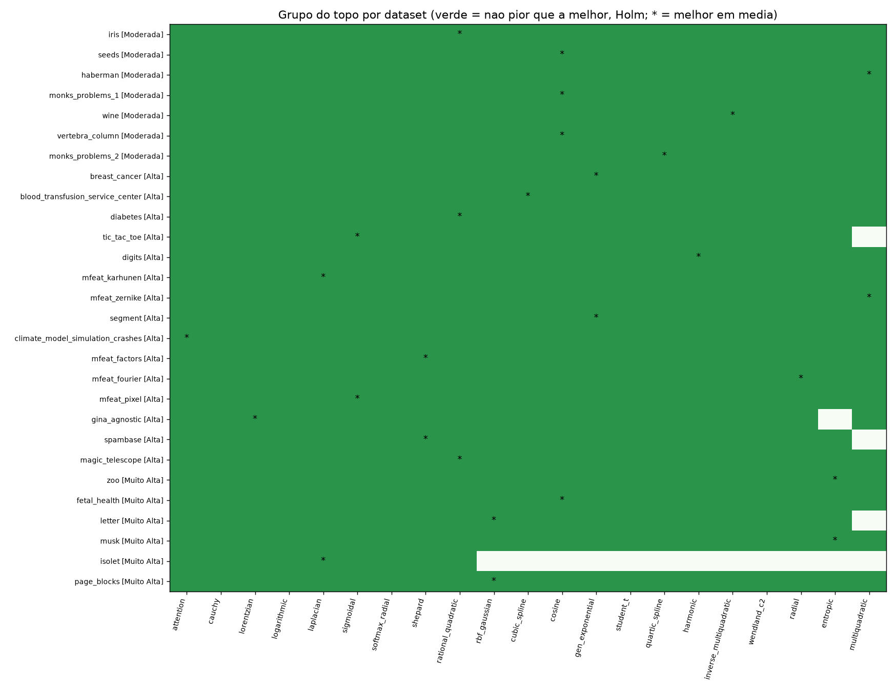
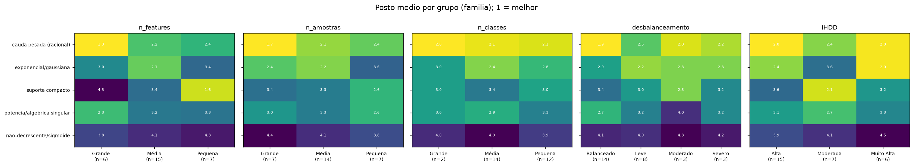
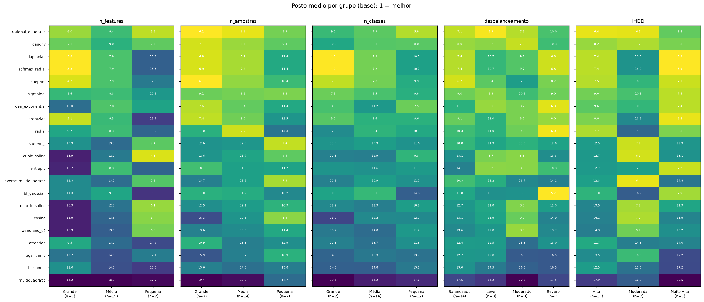

# Bateria estatistica (metrica: accuracy; alpha = 0.05; margem de equivalencia delta = 0.01)

- Datasets: **28**; bases: **21**; blocos pareados (seed x repeat x fold) por dataset: 30-90.

Metodologia e justificativas: ver `METODOLOGIA.md`.

## A. Por dataset

### A.1 Omnibus (Friedman + Iman-Davenport, ingenuo vs. com tamanho efetivo de amostra)

| dataset                          |   n_blocos |   deff |   n_eff |   p_friedman_naive |   p_friedman_deff |   p_friedman_deff_bh |
|:---------------------------------|-----------:|-------:|--------:|-------------------:|------------------:|---------------------:|
| blood_transfusion_service_center |         90 | 11     |   8.182 |         2.639e-27  |         0.7677    |            1         |
| breast_cancer                    |         90 | 11     |   8.182 |         0.05085    |         1         |            1         |
| climate_model_simulation_crashes |         90 | 11     |   8.182 |         0.4586     |         1         |            1         |
| diabetes                         |         90 | 11     |   8.182 |         1.138e-15  |         0.9691    |            1         |
| digits                           |         90 | 11     |   8.182 |         3.442e-12  |         0.9896    |            1         |
| fetal_health                     |         90 | 11     |   8.182 |         1.26e-20   |         0.9089    |            1         |
| gina_agnostic                    |         30 |  4.333 |   6.923 |         1.544e-45  |         1.414e-05 |            9.9e-05   |
| haberman                         |         90 | 11     |   8.182 |         3.592e-12  |         0.9896    |            1         |
| iris                             |         90 | 11     |   8.182 |         0.5142     |         1         |            1         |
| isolet                           |         30 |  4.333 |   6.923 |         3.355e-135 |         5.431e-22 |            1.521e-20 |
| letter                           |         30 |  4.333 |   6.923 |         6.531e-58  |         1.201e-07 |            1.121e-06 |
| magic_telescope                  |         30 |  4.333 |   6.923 |         4.112e-24  |         0.02098   |            0.06526   |
| mfeat_factors                    |         90 | 11     |   8.182 |         1.574e-16  |         0.9614    |            1         |
| mfeat_fourier                    |         90 | 11     |   8.182 |         2.605e-44  |         0.3184    |            0.8105    |
| mfeat_karhunen                   |         90 | 11     |   8.182 |         7.97e-110  |         0.0002801 |            0.00112   |
| mfeat_pixel                      |         90 | 11     |   8.182 |         8.012e-61  |         0.08209   |            0.2299    |
| mfeat_zernike                    |         90 | 11     |   8.182 |         1.036e-28  |         0.7313    |            1         |
| monks_problems_1                 |         90 | 11     |   8.182 |         1.886e-26  |         0.789     |            1         |
| monks_problems_2                 |         90 | 11     |   8.182 |         2.784e-25  |         0.8168    |            1         |
| musk                             |         30 |  4.333 |   6.923 |         9.935e-133 |         1.633e-21 |            2.286e-20 |
| page_blocks                      |         90 | 11     |   8.182 |         1.39e-37   |         0.4851    |            1         |
| seeds                            |         90 | 11     |   8.182 |         0.4481     |         1         |            1         |
| segment                          |         90 | 11     |   8.182 |         2.118e-122 |         5.12e-05  |            0.0002867 |
| spambase                         |         90 | 11     |   8.182 |         2.902e-96  |         0.001603  |            0.005611  |
| tic_tac_toe                      |         90 | 11     |   8.182 |         3.631e-114 |         0.0001571 |            0.0007329 |
| vertebra_column                  |         90 | 11     |   8.182 |         0.6495     |         1         |            1         |
| wine                             |         90 | 11     |   8.182 |         0.9937     |         1         |            1         |
| zoo                              |         90 | 11     |   8.182 |         1.049e-31  |         0.6493    |            1         |

Datasets com ao menos uma diferenca detectavel (omnibus corrigido, BH<0.05): **8/28**.

### A.2 Desfecho dos pares (Holm dentro de cada dataset; 3 vias)

| dataset                          |   pares |   diferenca_sig |   so_indicativo |   equivalente |   inconclusivo |   equiv_mas_forma_difere |   wilcoxon_discorda |
|:---------------------------------|--------:|----------------:|----------------:|--------------:|---------------:|-------------------------:|--------------------:|
| blood_transfusion_service_center |     210 |               0 |              21 |             9 |            201 |                        0 |                  24 |
| breast_cancer                    |     210 |               0 |               0 |             5 |            205 |                        0 |                   0 |
| climate_model_simulation_crashes |     210 |               0 |               0 |           210 |              0 |                        0 |                   0 |
| diabetes                         |     210 |               0 |              33 |             1 |            209 |                        0 |                  26 |
| digits                           |     210 |               0 |              11 |           208 |              2 |                        0 |                  10 |
| fetal_health                     |     210 |               0 |              36 |            13 |            197 |                        0 |                  36 |
| gina_agnostic                    |     210 |               4 |              42 |            73 |            133 |                        0 |                  53 |
| haberman                         |     210 |               0 |              40 |             1 |            209 |                        0 |                  22 |
| iris                             |     210 |               0 |               0 |             6 |            204 |                        0 |                   0 |
| isolet                           |     210 |              79 |              68 |            45 |             86 |                        0 |                  65 |
| letter                           |     210 |              20 |              78 |           187 |              3 |                        0 |                  52 |
| magic_telescope                  |     210 |               0 |              31 |           204 |              6 |                        0 |                  20 |
| mfeat_factors                    |     210 |               0 |              37 |           199 |             11 |                        0 |                  32 |
| mfeat_fourier                    |     210 |               0 |              76 |            10 |            200 |                        0 |                  75 |
| mfeat_karhunen                   |     210 |               0 |             100 |           113 |             97 |                        0 |                  97 |
| mfeat_pixel                      |     210 |               0 |              90 |           197 |             13 |                        0 |                  92 |
| mfeat_zernike                    |     210 |               0 |              52 |             5 |            205 |                        0 |                  47 |
| monks_problems_1                 |     210 |               0 |              58 |             2 |            208 |                        0 |                  49 |
| monks_problems_2                 |     210 |               0 |              21 |             2 |            208 |                        0 |                  21 |
| musk                             |     210 |               0 |              86 |           210 |              0 |                        0 |                  99 |
| page_blocks                      |     210 |               0 |              67 |           210 |              0 |                        0 |                  57 |
| seeds                            |     210 |               0 |               0 |             2 |            208 |                        0 |                   0 |
| segment                          |     210 |               4 |             138 |            90 |            116 |                        0 |                 130 |
| spambase                         |     210 |              13 |              89 |           104 |             93 |                        0 |                  90 |
| tic_tac_toe                      |     210 |               4 |             121 |             5 |            201 |                        0 |                 121 |
| vertebra_column                  |     210 |               0 |               0 |             4 |            206 |                        0 |                   0 |
| wine                             |     210 |               0 |               0 |            10 |            200 |                        0 |                   0 |
| zoo                              |     210 |               0 |              20 |            40 |            170 |                        0 |                  20 |

`diferenca_sig` = robusto (sobrevive a correcao N-B + Holm); `so_indicativo` = significativo apenas sem a correcao N-B (Holm). `wilcoxon_discorda` = Wilcoxon ingenuo (Holm) discorda do t corrigido.

### A.3 Grupo do topo por dataset (bases nao significativamente piores que a melhor em media)

| dataset                          | IHDD       | melhor                 |   media_melhor |   n_no_topo |   n_no_topo_indicativo | topo                                                                                                                       |
|:---------------------------------|:-----------|:-----------------------|---------------:|------------:|-----------------------:|:---------------------------------------------------------------------------------------------------------------------------|
| blood_transfusion_service_center | Alta       | cubic_spline           |         0.7889 |          21 |                     19 | cubic_spline, wendland_c2, rational_quadratic, student_t, quartic_spline, radial, gen_exponential, cosine ...              |
| breast_cancer                    | Alta       | gen_exponential        |         0.9681 |          21 |                     21 | gen_exponential, sigmoidal, entropic, cubic_spline, radial, rbf_gaussian, cosine, shepard ...                              |
| climate_model_simulation_crashes | Alta       | attention              |         0.9154 |          21 |                     21 | attention, cauchy, cosine, cubic_spline, gen_exponential, radial, harmonic, inverse_multiquadratic ...                     |
| diabetes                         | Alta       | rational_quadratic     |         0.7525 |          21 |                      8 | rational_quadratic, cauchy, laplacian, softmax_radial, radial, lorentzian, gen_exponential, inverse_multiquadratic ...     |
| digits                           | Alta       | harmonic               |         0.9781 |          21 |                     20 | harmonic, shepard, logarithmic, inverse_multiquadratic, student_t, rational_quadratic, attention, cauchy ...               |
| fetal_health                     | Muito Alta | cosine                 |         0.9096 |          21 |                     18 | cosine, quartic_spline, lorentzian, wendland_c2, cubic_spline, cauchy, sigmoidal, rational_quadratic ...                   |
| gina_agnostic                    | Alta       | lorentzian             |         0.8185 |          20 |                     17 | lorentzian, attention, harmonic, rational_quadratic, shepard, laplacian, softmax_radial, cauchy ...                        |
| haberman                         | Moderada   | multiquadratic         |         0.7414 |          21 |                     10 | multiquadratic, inverse_multiquadratic, student_t, logarithmic, harmonic, attention, sigmoidal, rational_quadratic ...     |
| iris                             | Moderada   | rational_quadratic     |         0.9684 |          21 |                     21 | rational_quadratic, shepard, sigmoidal, cauchy, cubic_spline, wendland_c2, quartic_spline, cosine ...                      |
| isolet                           | Muito Alta | laplacian              |         0.9167 |           9 |                      5 | laplacian, softmax_radial, shepard, lorentzian, rational_quadratic, attention, cauchy, logarithmic ...                     |
| letter                           | Muito Alta | rbf_gaussian           |         0.95   |          20 |                     12 | rbf_gaussian, entropic, sigmoidal, gen_exponential, radial, softmax_radial, laplacian, shepard ...                         |
| magic_telescope                  | Alta       | rational_quadratic     |         0.8428 |          21 |                     18 | rational_quadratic, entropic, gen_exponential, cauchy, cubic_spline, radial, attention, sigmoidal ...                      |
| mfeat_factors                    | Alta       | shepard                |         0.9687 |          21 |                     14 | shepard, laplacian, softmax_radial, rational_quadratic, cauchy, lorentzian, radial, student_t ...                          |
| mfeat_fourier                    | Alta       | radial                 |         0.804  |          21 |                     14 | radial, laplacian, softmax_radial, sigmoidal, rational_quadratic, shepard, cauchy, lorentzian ...                          |
| mfeat_karhunen                   | Alta       | laplacian              |         0.9621 |          21 |                      7 | laplacian, softmax_radial, sigmoidal, radial, rbf_gaussian, entropic, gen_exponential, lorentzian ...                      |
| mfeat_pixel                      | Alta       | sigmoidal              |         0.9796 |          21 |                     14 | sigmoidal, rbf_gaussian, laplacian, softmax_radial, radial, lorentzian, shepard, rational_quadratic ...                    |
| mfeat_zernike                    | Alta       | multiquadratic         |         0.8183 |          21 |                      2 | multiquadratic, radial, rbf_gaussian, cauchy, laplacian, softmax_radial, rational_quadratic, sigmoidal ...                 |
| monks_problems_1                 | Moderada   | cosine                 |         0.8836 |          21 |                     12 | cosine, quartic_spline, rational_quadratic, cubic_spline, wendland_c2, gen_exponential, cauchy, inverse_multiquadratic ... |
| monks_problems_2                 | Moderada   | quartic_spline         |         0.8709 |          21 |                     19 | quartic_spline, wendland_c2, cubic_spline, rational_quadratic, cauchy, gen_exponential, shepard, laplacian ...             |
| musk                             | Muito Alta | entropic               |         0.9994 |          21 |                     14 | entropic, cauchy, lorentzian, laplacian, gen_exponential, sigmoidal, shepard, rbf_gaussian ...                             |
| page_blocks                      | Muito Alta | rbf_gaussian           |         0.9688 |          21 |                      9 | rbf_gaussian, radial, gen_exponential, laplacian, softmax_radial, rational_quadratic, cauchy, lorentzian ...               |
| seeds                            | Moderada   | cosine                 |         0.9263 |          21 |                     21 | cosine, quartic_spline, cubic_spline, cauchy, wendland_c2, sigmoidal, inverse_multiquadratic, student_t ...                |
| segment                          | Alta       | gen_exponential        |         0.9581 |          21 |                      6 | gen_exponential, radial, rbf_gaussian, laplacian, softmax_radial, shepard, entropic, rational_quadratic ...                |
| spambase                         | Alta       | shepard                |         0.9261 |          20 |                     11 | shepard, lorentzian, rational_quadratic, cauchy, sigmoidal, softmax_radial, laplacian, quartic_spline ...                  |
| tic_tac_toe                      | Alta       | sigmoidal              |         0.9347 |          20 |                      4 | sigmoidal, entropic, radial, shepard, gen_exponential, lorentzian, softmax_radial, laplacian ...                           |
| vertebra_column                  | Moderada   | cosine                 |         0.8302 |          21 |                     21 | cosine, rbf_gaussian, logarithmic, cubic_spline, student_t, inverse_multiquadratic, entropic, rational_quadratic ...       |
| wine                             | Moderada   | inverse_multiquadratic |         0.9784 |          21 |                     21 | inverse_multiquadratic, student_t, logarithmic, lorentzian, entropic, softmax_radial, laplacian, multiquadratic ...        |
| zoo                              | Muito Alta | entropic               |         0.9476 |          21 |                     20 | entropic, softmax_radial, lorentzian, laplacian, gen_exponential, sigmoidal, shepard, rbf_gaussian ...                     |

### A.4 Frequencia agregada entre datasets

| basis                  |   vezes_no_topo |   vezes_melhor |   vezes_no_topo_indicativo |   vitorias_sig |   derrotas_sig |
|:-----------------------|----------------:|---------------:|---------------------------:|---------------:|---------------:|
| attention              |              28 |              1 |                         18 |              9 |              0 |
| cauchy                 |              28 |              0 |                         21 |              8 |              0 |
| lorentzian             |              28 |              1 |                         21 |             13 |              0 |
| logarithmic            |              28 |              0 |                         17 |              2 |              1 |
| laplacian              |              28 |              2 |                         24 |             14 |              0 |
| sigmoidal              |              28 |              2 |                         22 |              6 |              0 |
| softmax_radial         |              28 |              0 |                         24 |             14 |              0 |
| shepard                |              28 |              2 |                         22 |             13 |              0 |
| rational_quadratic     |              28 |              3 |                         23 |             11 |              0 |
| rbf_gaussian           |              27 |              2 |                         19 |              3 |              6 |
| cubic_spline           |              27 |              1 |                         16 |              4 |              7 |
| cosine                 |              27 |              4 |                         13 |              2 |              7 |
| gen_exponential        |              27 |              2 |                         23 |              3 |              7 |
| student_t              |              27 |              0 |                         19 |              3 |              2 |
| quartic_spline         |              27 |              1 |                         16 |              3 |              7 |
| harmonic               |              27 |              1 |                         14 |              3 |              2 |
| inverse_multiquadratic |              27 |              1 |                         19 |              2 |              2 |
| wendland_c2            |              27 |              0 |                         16 |              3 |              7 |
| radial                 |              27 |              1 |                         25 |              5 |              6 |
| entropic               |              26 |              2 |                         17 |              2 |             24 |
| multiquadratic         |              24 |              2 |                         10 |              1 |             46 |

## B. Por grupo de datasets

### B.1 Nivel de familia

**Dependencia do perfil de postos em relacao ao grupo (permutacao global):**

| criterio         |      T |      p |   n_groups |   min_group |   p_holm |
|:-----------------|-------:|-------:|-----------:|------------:|---------:|
| n_features       | 48.3   | 0.0035 |          3 |           6 |   0.0175 |
| n_amostras       | 16.43  | 0.4101 |          3 |           7 |   1      |
| n_classes        |  4.452 | 0.9665 |          3 |           2 |   1      |
| desbalanceamento | 13.24  | 0.8699 |          4 |           3 |   1      |
| IHDD             | 23.92  | 0.1589 |          3 |           6 |   0.6356 |

**Friedman dentro de cada grupo:**

| criterio         | nivel      |   n_datasets |   k |        F |         p_F |   CD_nemenyi | top3                                                                        | pior                     |   p_F_holm |
|:-----------------|:-----------|-------------:|----:|---------:|------------:|-------------:|:----------------------------------------------------------------------------|:-------------------------|-----------:|
| n_features       | Grande     |            6 |   5 |   8.043  |   0.000491  |        2.49  | cauda pesada (racional), potencia/algebrica singular, exponencial/gaussiana | suporte compacto         |   0.007365 |
| n_features       | Média      |           15 |   5 |   5.876  |   0.000508  |        1.575 | exponencial/gaussiana, cauda pesada (racional), potencia/algebrica singular | nao-decrescente/sigmoide |   0.007365 |
| n_features       | Pequena    |            7 |   5 |   4.5    |   0.007446  |        2.305 | suporte compacto, cauda pesada (racional), potencia/algebrica singular      | nao-decrescente/sigmoide |   0.06701  |
| n_amostras       | Grande     |            7 |   5 |   4.352  |   0.008687  |        2.305 | cauda pesada (racional), exponencial/gaussiana, potencia/algebrica singular | nao-decrescente/sigmoide |   0.06949  |
| n_amostras       | Média      |           14 |   5 |   4.719  |   0.002524  |        1.63  | cauda pesada (racional), exponencial/gaussiana, potencia/algebrica singular | nao-decrescente/sigmoide |   0.02524  |
| n_amostras       | Pequena    |            7 |   5 |   1.261  |   0.3127    |        2.305 | cauda pesada (racional), potencia/algebrica singular, suporte compacto      | nao-decrescente/sigmoide |   0.7923   |
| n_classes        | Grande     |            2 |   5 | nan      | nan         |        4.313 | cauda pesada (racional), potencia/algebrica singular, exponencial/gaussiana | nao-decrescente/sigmoide | nan        |
| n_classes        | Média      |           14 |   5 |   5.544  |   0.0008554 |        1.63  | cauda pesada (racional), exponencial/gaussiana, potencia/algebrica singular | nao-decrescente/sigmoide |   0.01112  |
| n_classes        | Pequena    |           12 |   5 |   2.339  |   0.06986   |        1.761 | cauda pesada (racional), exponencial/gaussiana, suporte compacto            | nao-decrescente/sigmoide |   0.4192   |
| desbalanceamento | Balanceado |           14 |   5 |   4.868  |   0.00207   |        1.63  | cauda pesada (racional), potencia/algebrica singular, exponencial/gaussiana | nao-decrescente/sigmoide |   0.02277  |
| desbalanceamento | Leve       |            8 |   5 |   1.615  |   0.1981    |        2.156 | exponencial/gaussiana, cauda pesada (racional), suporte compacto            | nao-decrescente/sigmoide |   0.7923   |
| desbalanceamento | Moderado   |            3 |   5 |   1.75   |   0.2319    |        3.522 | cauda pesada (racional), exponencial/gaussiana, suporte compacto            | nao-decrescente/sigmoide |   0.7923   |
| desbalanceamento | Severo     |            3 |   5 |   0.8846 |   0.5145    |        3.522 | cauda pesada (racional), exponencial/gaussiana, potencia/algebrica singular | nao-decrescente/sigmoide |   0.7923   |
| IHDD             | Alta       |           15 |   5 |   5.284  |   0.001107  |        1.575 | cauda pesada (racional), exponencial/gaussiana, potencia/algebrica singular | nao-decrescente/sigmoide |   0.01328  |
| IHDD             | Moderada   |            7 |   5 |   2.305  |   0.08755   |        2.305 | suporte compacto, cauda pesada (racional), potencia/algebrica singular      | nao-decrescente/sigmoide |   0.4377   |
| IHDD             | Muito Alta |            6 |   5 |   3.911  |   0.01667   |        2.49  | cauda pesada (racional), exponencial/gaussiana, suporte compacto            | nao-decrescente/sigmoide |   0.1167   |

**Kruskal-Wallis por base (Holm global): 0 significativos.**

| basis                       |       H |        p | melhor_grupo   | pior_grupo   |   posto_melhor |   posto_pior |   p_holm | criterio   |
|:----------------------------|--------:|---------:|:---------------|:-------------|---------------:|-------------:|---------:|:-----------|
| suporte compacto            | 11.92   | 0.002578 | Pequena        | Grande       |          1.571 |        4.5   |  0.01289 | n_features |
| cauda pesada (racional)     |  6.732  | 0.03452  | Grande         | Pequena      |          1.333 |        2.429 |  0.1381  | n_features |
| exponencial/gaussiana       |  4.828  | 0.08945  | Média          | Pequena      |          2.067 |        3.429 |  0.2683  | n_features |
| potencia/algebrica singular |  4.605  | 0.1      | Grande         | Pequena      |          2.333 |        3.286 |  0.2683  | n_features |
| nao-decrescente/sigmoide    |  3.189  | 0.203    | Grande         | Pequena      |          3.833 |        4.286 |  0.2683  | n_features |
| exponencial/gaussiana       |  3.932  | 0.14     | Média          | Pequena      |          2.214 |        3.571 |  0.7002  | n_amostras |
| cauda pesada (racional)     |  2.071  | 0.3551   | Grande         | Pequena      |          1.714 |        2.357 |  1       | n_amostras |
| potencia/algebrica singular |  1.703  | 0.4268   | Pequena        | Média        |          2.643 |        3.286 |  1       | n_amostras |
| suporte compacto            |  0.9651 | 0.6172   | Pequena        | Grande       |          2.643 |        3.429 |  1       | n_amostras |
| nao-decrescente/sigmoide    |  0.5932 | 0.7433   | Pequena        | Grande       |          3.786 |        4.429 |  1       | n_amostras |

**Spearman posto x covariavel (BH): 0 significativos.**

| basis                       | covariavel            |   rho_spearman |       p |   p_bh |
|:----------------------------|:----------------------|---------------:|--------:|-------:|
| suporte compacto            | log10(n features)     |         0.4675 | 0.01214 | 0.2427 |
| cauda pesada (racional)     | log10(n features)     |        -0.3567 | 0.0624  | 0.5668 |
| exponencial/gaussiana       | log10(n amostras)     |        -0.3151 | 0.1024  | 0.5668 |
| nao-decrescente/sigmoide    | log10(n features)     |        -0.2797 | 0.1495  | 0.5668 |
| suporte compacto            | n classes             |         0.2696 | 0.1654  | 0.5668 |
| cauda pesada (racional)     | log10(indice desbal.) |         0.2644 | 0.1739  | 0.5668 |
| potencia/algebrica singular | log10(n features)     |        -0.2506 | 0.1984  | 0.5668 |
| suporte compacto            | log10(n amostras)     |         0.2342 | 0.2304  | 0.5759 |
| cauda pesada (racional)     | log10(n amostras)     |        -0.194  | 0.3225  | 0.7154 |
| suporte compacto            | log10(indice desbal.) |        -0.1697 | 0.3878  | 0.7154 |

### B.2 Nivel de base

**Dependencia do perfil de postos em relacao ao grupo (permutacao global):**

| criterio         |      T |      p |   n_groups |   min_group |   p_holm |
|:-----------------|-------:|-------:|-----------:|------------:|---------:|
| n_features       | 4313   | 0.0001 |          3 |           6 |   0.0005 |
| n_amostras       | 1495   | 0.2617 |          3 |           7 |   0.7851 |
| n_classes        |  947.1 | 0.7429 |          3 |           2 |   1      |
| desbalanceamento | 1347   | 0.847  |          4 |           3 |   1      |
| IHDD             | 2894   | 0.0045 |          3 |           6 |   0.018  |

**Friedman dentro de cada grupo:**

| criterio         | nivel      |   n_datasets |   k |        F |         p_F |   CD_nemenyi | top3                                                     | pior           |    p_F_holm |
|:-----------------|:-----------|-------------:|----:|---------:|------------:|-------------:|:---------------------------------------------------------|:---------------|------------:|
| n_features       | Grande     |            6 |  21 |   8.035  |   2.826e-13 |       12.79  | laplacian, softmax_radial, shepard                       | multiquadratic |   4.24e-12  |
| n_features       | Média      |           15 |  21 |   4.98   |   1.747e-10 |        8.086 | gen_exponential, shepard, laplacian                      | multiquadratic |   2.446e-09 |
| n_features       | Pequena    |            7 |  21 |   4.712  |   3.375e-08 |       11.84  | cubic_spline, rational_quadratic, quartic_spline         | multiquadratic |   4.05e-07  |
| n_amostras       | Grande     |            7 |  21 |   3.504  |   9.746e-06 |       11.84  | rational_quadratic, shepard, laplacian                   | multiquadratic |   6.822e-05 |
| n_amostras       | Média      |           14 |  21 |   4.066  |   5.571e-08 |        8.37  | rational_quadratic, radial, laplacian                    | multiquadratic |   6.128e-07 |
| n_amostras       | Pequena    |            7 |  21 |   0.9332 |   0.5471    |       11.84  | student_t, inverse_multiquadratic, cosine                | multiquadratic |   0.8364    |
| n_classes        | Grande     |            2 |  21 | nan      | nan         |       22.15  | laplacian, softmax_radial, shepard                       | multiquadratic | nan         |
| n_classes        | Média      |           14 |  21 |   3.78   |   3.092e-07 |        8.37  | laplacian, softmax_radial, shepard                       | multiquadratic |   2.783e-06 |
| n_classes        | Pequena    |           12 |  21 |   2.505  |   0.0005973 |        9.041 | rational_quadratic, gen_exponential, cauchy              | multiquadratic |   0.003584  |
| desbalanceamento | Balanceado |           14 |  21 |   3.394  |   3.073e-06 |        8.37  | shepard, rational_quadratic, laplacian                   | multiquadratic |   2.458e-05 |
| desbalanceamento | Leve       |            8 |  21 |   1.644  |   0.05041   |       11.07  | rational_quadratic, gen_exponential, cauchy              | multiquadratic |   0.1512    |
| desbalanceamento | Moderado   |            3 |  21 |   1.066  |   0.4182    |       18.08  | cauchy, rational_quadratic, wendland_c2                  | multiquadratic |   0.8364    |
| desbalanceamento | Severo     |            3 |  21 |   2.182  |   0.01767   |       18.08  | rbf_gaussian, radial, gen_exponential                    | multiquadratic |   0.07066   |
| IHDD             | Alta       |           15 |  21 |   4.761  |   6.65e-10  |        8.086 | rational_quadratic, laplacian, softmax_radial            | multiquadratic |   8.645e-09 |
| IHDD             | Moderada   |            7 |  21 |   2.561  |   0.0008831 |       11.84  | inverse_multiquadratic, rational_quadratic, cubic_spline | multiquadratic |   0.004416  |
| IHDD             | Muito Alta |            6 |  21 |   4.77   |   6.865e-08 |       12.79  | laplacian, softmax_radial, lorentzian                    | multiquadratic |   6.865e-07 |

**Kruskal-Wallis por base (Holm global): 0 significativos.**

| basis                  |      H |         p | melhor_grupo   | pior_grupo   |   posto_melhor |   posto_pior |   p_holm | criterio   |
|:-----------------------|-------:|----------:|:---------------|:-------------|---------------:|-------------:|---------:|:-----------|
| cubic_spline           | 14.13  | 0.0008542 | Pequena        | Grande       |          4.643 |        16.92 |  0.01794 | n_features |
| lorentzian             | 13.4   | 0.001233  | Grande         | Pequena      |          5.083 |        15.5  |  0.02465 | n_features |
| laplacian              | 12.33  | 0.002097  | Grande         | Pequena      |          3.833 |        13.79 |  0.03985 | n_features |
| softmax_radial         | 12.33  | 0.002097  | Grande         | Pequena      |          3.833 |        13.79 |  0.03985 | n_features |
| quartic_spline         | 11.21  | 0.003676  | Pequena        | Grande       |          6.071 |        16.92 |  0.06249 | n_features |
| wendland_c2            | 10.12  | 0.006347  | Pequena        | Grande       |          6.786 |        16.92 |  0.1015  | n_features |
| cosine                 |  9.211 | 0.009997  | Pequena        | Grande       |          6.357 |        16.92 |  0.15    | n_features |
| student_t              |  8.511 | 0.01419   | Pequena        | Média        |          7.429 |        13.13 |  0.1986  | n_features |
| inverse_multiquadratic |  7.696 | 0.02132   | Pequena        | Média        |          7.643 |        13.07 |  0.2772  | n_features |
| shepard                |  7.629 | 0.02205   | Grande         | Pequena      |          4.667 |        12.29 |  0.2772  | n_features |

**Spearman posto x covariavel (BH): 7 significativos.**

| basis          | covariavel        |   rho_spearman |         p |    p_bh |
|:---------------|:------------------|---------------:|----------:|--------:|
| lorentzian     | log10(n features) |        -0.6577 | 0.0001426 | 0.01198 |
| cubic_spline   | log10(n features) |         0.6068 | 0.0006187 | 0.01614 |
| laplacian      | log10(n features) |        -0.5971 | 0.0007942 | 0.01614 |
| softmax_radial | log10(n features) |        -0.5971 | 0.0007942 | 0.01614 |
| shepard        | log10(n features) |        -0.5896 | 0.0009607 | 0.01614 |
| softmax_radial | n classes         |        -0.5602 | 0.001931  | 0.02318 |
| laplacian      | n classes         |        -0.5602 | 0.001931  | 0.02318 |
| cosine         | log10(n amostras) |         0.4928 | 0.007718  | 0.08104 |
| quartic_spline | log10(n features) |         0.4758 | 0.0105    | 0.09797 |
| cubic_spline   | n classes         |         0.4574 | 0.0144    | 0.121   |

## Diagnostico: vies de selecao do random search (melhor - mediana das combinacoes, escala da metrica de tuning)

| basis                  |     gap |
|:-----------------------|--------:|
| lorentzian             | 0.01222 |
| rational_quadratic     | 0.01497 |
| shepard                | 0.01656 |
| sigmoidal              | 0.01837 |
| attention              | 0.0194  |
| softmax_radial         | 0.0199  |
| laplacian              | 0.02021 |
| cauchy                 | 0.02049 |
| quartic_spline         | 0.02061 |
| gen_exponential        | 0.02063 |
| cubic_spline           | 0.02152 |
| wendland_c2            | 0.02179 |
| student_t              | 0.02184 |
| rbf_gaussian           | 0.02283 |
| inverse_multiquadratic | 0.02312 |
| harmonic               | 0.02407 |
| radial                 | 0.02511 |
| cosine                 | 0.02552 |
| logarithmic            | 0.02627 |
| entropic               | 0.03629 |
| multiquadratic         | 0.0403  |